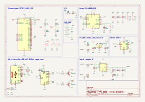

## Trabajo práctico INTEGRADOR de la asignatura DCI ##
Este repositorio contiene el trabajo práctico final para la asignatura de Diseño de Circuitos Impresos de la carrera de posgrado de FIUBA.

* Autor: Rodrigo Antonio Berrezueta Guerrero
* Título corto del trabajo: ESP32 + MPU-6050 + monitor de batería
* Descripción: Placa basada en el módulo ESP32-WROOM-32D que lee un sensor inercial MPU-6050 (acelerómetro y giróscopo de 6 ejes) y mide el consumo y la tensión de una batería con un monitor de corriente INA219, ambos por I2C. Se alimenta desde USB-C o desde una batería, cuya tensión se eleva a 5 V con un convertidor boost TPS61023; la selección entre ambas fuentes se hace con diodos Schottky y un regulador AMS1117 genera los 3,3 V. Incluye un conversor USB-UART CH340K con circuito de auto-reset para programar el ESP32 sin pulsar botones. El objetivo es obtener un nodo portátil de medición de movimiento que reporte también el estado de su batería.
* Cursada: OCT-NOV-DIC 2026

## Licencia de este trabajo ##
Este trabajo se distribuye bajo la licencia de hardware abierto **CERN Open Hardware Licence Version 2 - Strongly Reciprocal (CERN-OHL-S-2.0)**.
El texto completo está en el archivo [LICENSE](LICENSE) del directorio raíz.

## Estructura del repositorio ##

* [doc](doc/): documentación propia (propuesta, notas, cálculos, revisiones).
* [info](info/): hojas de datos de los componentes principales.
* [pcb](pcb/): proyecto KiCad (esquemático, PCB, librerías propias y archivos generados como la BOM).

## Componentes principales ##

| Ref. | Componente | Función |
|---|---|---|
| U1 | ESP32-WROOM-32D | Microcontrolador con Wi-Fi/Bluetooth |
| U2 | CH340K | Conversor USB-UART |
| U3 | MPU-6050 | Acelerómetro + giróscopo (I2C, 0x68) |
| U4 | INA219 | Monitor de corriente y tensión de batería (I2C, 0x40) |
| U5 | AMS1117-3.3 | Regulador lineal 3,3 V |
| U6 | TPS61023 | Boost de batería a 5 V |
| J1 | USB4105 | Conector USB-C |

La lista de materiales completa, con números de parte, está en [pcb/salidas/BOM.csv](pcb/salidas/BOM.csv).

## Herramientas ##
* KiCad 10.0
