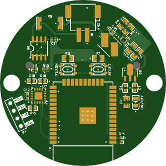
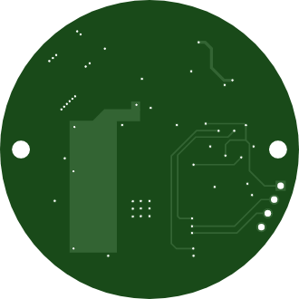
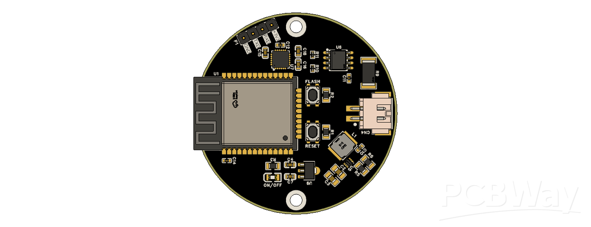
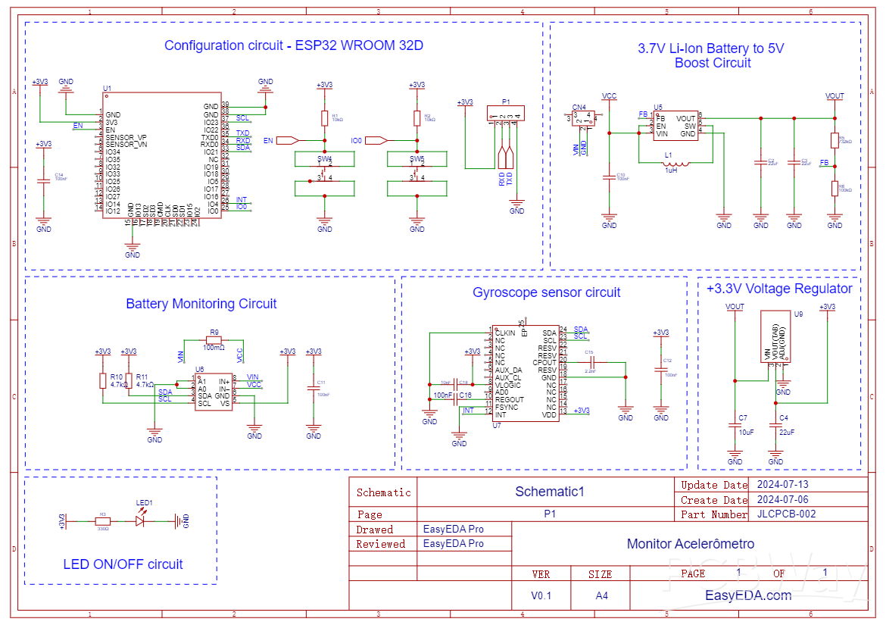
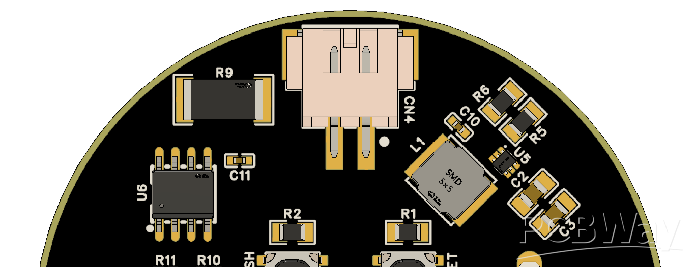
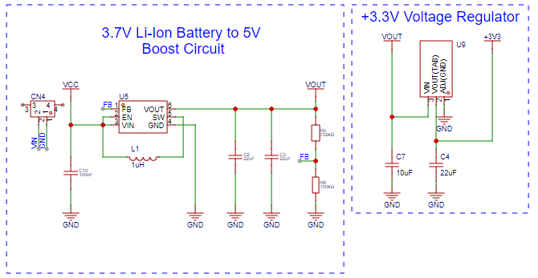
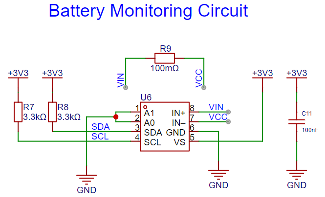

## Propuesta ##

Información presentada en el formulario de propuesta del TP INTEGRADOR.

| Campo | Valor |
|---|---|
| Título | ESP32 MPU6050 Monitor |
| Modalidad | Réplica de módulo con agregados menores, relacionada con la tesis final |
| Proyecto de origen | [ESP32 MPU6050 Monitor – PCBWay](https://www.pcbway.com/project/shareproject/ESP32_Accelerometer_77ebcd48.html) |
| Capas | 2 |
| Componentes | Solo en la cara superior |
| Cantidad aproximada de componentes | 33 |

### Objetivo ###
Rediseñar la placa agregando un conversor USB-UART (CH340) y un conector USB-C, para tener comunicación con el ESP32 y poder programarlo de forma más fácil, sin un adaptador externo. El diseño se va a aplicar en la tesis final.

### Devolución del docente ###
> Se acepta la propuesta, siempre que los agregados sean menores y los pueda definir rápidamente para definir el esquemático.

### Módulo original ###
Placa circular basada en ESP32-WROOM-32D con:
* MPU-6050 (acelerómetro + giróscopo) por I2C.
* INA219 para monitorear tensión y corriente de la batería, por I2C.
* Batería Li-Ion de 3,7 V elevada a 5 V con un boost TPS61023.
* Regulador de 3,3 V para el ESP32.
* Pines de programación (+3V3, TXD, RXD, GND), pulsadores RESET y FLASH, y LED de encendido.
* Dos agujeros de sujeción.

| Vista superior | Vista inferior |
|---|---|
|  |  |

### Esquemático de referencia ###

Detalle de los bloques:

| Conector de batería | Boost TPS61023 | Monitor INA219 |
|---|---|---|
|  |  |  |

### Cambios respecto del original ###
* Se agrega USB-C (J1) con resistencias de 5,1 kΩ en CC1/CC2.
* Se agrega el conversor USB-UART CH340K (U2) con auto-reset (Q1, Q2) para programar el ESP32 sin presionar los pulsadores.
* Se agrega la selección de alimentación USB/batería con diodos Schottky SS14 (D1, D2).
* Se reemplaza el conector de programación P1 por la conexión USB.

### Créditos y licencia del original ###
Diseño original: **Silícios Lab**, publicado en PCBWay bajo licencia [CC BY-SA 3.0](https://creativecommons.org/licenses/by-sa/3.0/). Las imágenes de este directorio son de ese proyecto y se usan con atribución.
